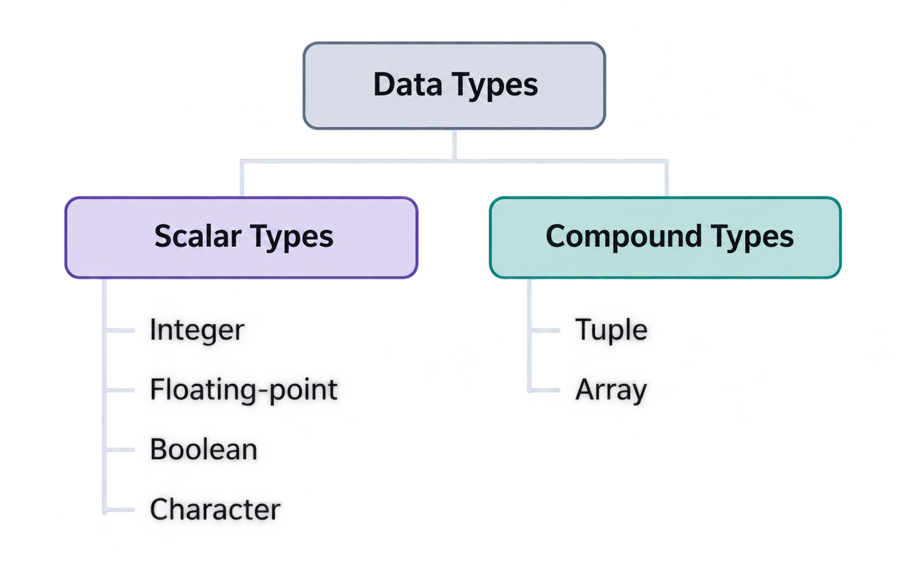
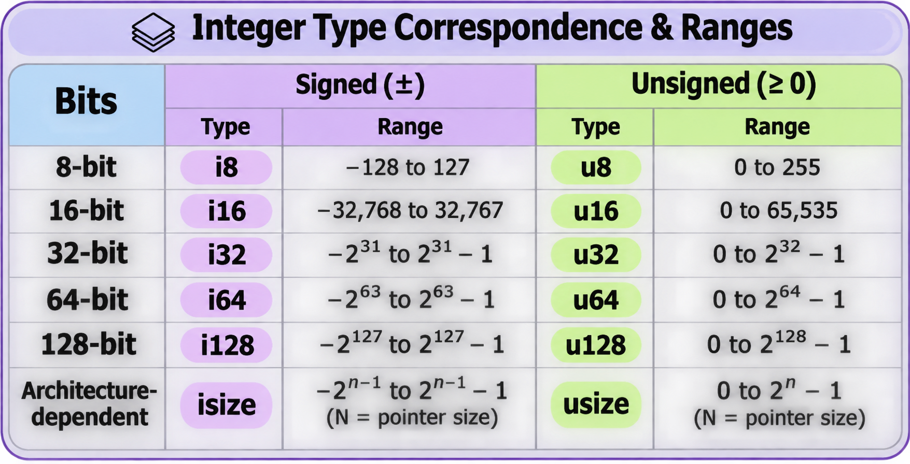
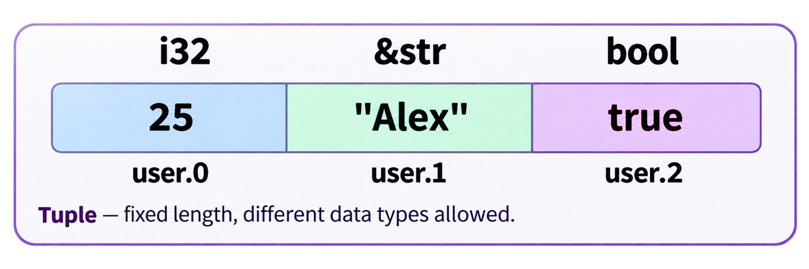
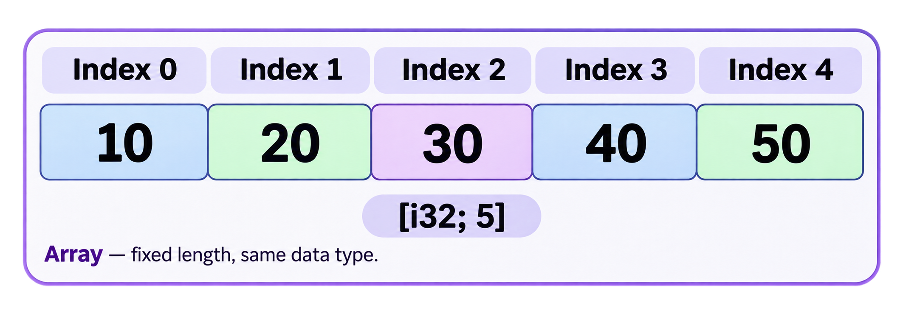

# Data Types

Every Rust value has a type. The type tells the compiler which values are valid and which operations are available. Rust often infers a type from context, but you can add an annotation when clarity or precision is needed.



## Contents

1. [Scalar types](#1-scalar-types)
2. [Compound types](#2-compound-types)
3. [Strings](#3-strings)
4. [Type annotations and literals](#4-type-annotations-and-literals)
5. [Choosing a type](#5-choosing-a-type)

## 1. Scalar types

Scalar types represent one value.

### 1.1 Integers

Integers store whole numbers without decimal points. Signed types can represent negative and positive values. Unsigned types represent zero and positive values only.



```rust
let temperature: i32 = -10;
let age: u8 = 25;
let population: u64 = 1_000_000;
```

The default integer type is usually `i32`. Use an explicit type when the required range, platform size, or API contract makes it important.

### 1.2 Floating-point numbers

Floating-point types store numbers with decimal points. Rust provides two sizes:

| Type | Size | Precision |
| --- | --- | --- |
| `f32` | 32-bit | Single precision |
| `f64` | 64-bit | Double precision |

```rust
let price: f32 = 99.99;
let pi: f64 = 3.14159265359;
```

`f64` is the usual default because it provides greater precision. Floating-point calculations can have small rounding differences, so avoid using them for exact financial values.

### 1.3 Boolean

`bool` has exactly two values: `true` and `false`.

```rust
let is_ready: bool = true;
```

### 1.4 Character

`char` stores one Unicode scalar value and uses single quotes. It can represent more than an ASCII letter.

```rust
let initial: char = 'R';
let symbol: char = '★';
```

## 2. Compound types

Compound types group multiple values into one value.

### 2.1 Tuples

A tuple stores a fixed number of values and may contain different types. You can annotate its type, access elements by position starting at zero, or destructure it:

```rust
let user: (i32, &str, bool) = (25, "Alex", true);

println!("{}", user.0); // 25
println!("{}", user.1); // Alex

// Tuple destructuring
let (age, name, active) = user;
```



### 2.2 Arrays

An array stores a fixed number of values, and every element must have the same type. Its length is part of the type.

```rust
let numbers: [i32; 5] = [10, 20, 30, 40, 50];

println!("{}", numbers[0]); // 10
```



Array indexing starts at zero. An invalid index causes a runtime panic, so validate dynamic indexes when necessary.

## 3. Strings

Rust commonly uses two string forms:

- `&str` is a borrowed, immutable string slice, often used for text literals.
- `String` is an owned, growable UTF-8 string.

```rust
let greeting: &str = "Hello";
let mut message = String::from("Hello");
message.push_str(", Rust!");
```

Use [Type Conversion](<../07 - Type Conversion/README.md>) when converting between textual and numeric values.

## 4. Type annotations and literals

Write an annotation after the binding name when you want to make the type explicit:

```rust
let count: i64 = 30;
let ratio: f32 = 0.5;
```

Literal suffixes can also specify a numeric type:

```rust
let distance = 10u64;
let precise = 3.14f32;
```

Rust does not silently mix numeric types. Convert values explicitly before combining them; see [Type Conversion](<../07 - Type Conversion/README.md>).

## 5. Choosing a type

- Choose a signed integer when negative values are valid.
- Choose an unsigned integer for non-negative counts, sizes, or indexes.
- Use `f64` when decimal precision matters.
- Use an array for a fixed-size collection and a `Vec<T>` for a growable collection.
- Use `&str` for borrowed text and `String` when ownership or mutation is needed.

## 6. Practice

1. Declare one value for each scalar type.
2. Create a tuple containing a name, age, and active flag.
3. Create an array of three scores and print its second element.
4. Append text to an owned `String`.
5. Try combining `i32` and `f64` values, then convert them explicitly.

## Source reference

This lesson was informed by the [W3Schools Rust Data Types tutorial](https://www.w3schools.com/rust/rust_data_types.php) and expanded with Rust-specific guidance on ownership, Unicode characters, arrays, and numeric types.

## Related lessons

- [Collections and Strings](<../../08 - Collections and Strings/README.md>) expands on arrays, tuples, growable collections, and UTF-8.

---

[← Previous: Shadowing](<../04 - Shadowing/README.md>) | [Back to Programming Fundamentals](../README.md) | [Next: Type Inference →](<../06 - Type Inference/README.md>)
