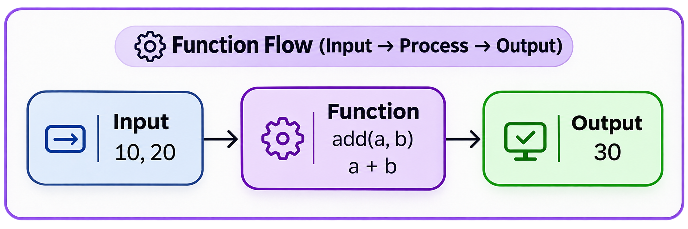
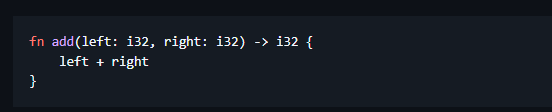

# Functions

Functions group reusable behavior behind a name. They define a clear boundary for inputs, outputs, scope, and errors while Rust checks every type at compile time.



## Contents

1. [Define and call functions](#1-define-and-call-functions)
2. [Parameters and arguments](#2-parameters-and-arguments)
3. [Return values](#3-return-values)
4. [Statements and expressions](#4-statements-and-expressions)
5. [Function scope](#5-function-scope)
6. [Ownership at function boundaries](#6-ownership-at-function-boundaries)
7. [Borrowing parameters](#7-borrowing-parameters)
8. [Closures](#8-closures)
9. [Error-returning functions](#9-error-returning-functions)
10. [Best practices](#10-best-practices)

## 1. Define and call functions

Declare a function with `fn`, a name, parentheses, and a body. `main` is the program's entry point:

```rust
fn greet() {
    println!("Hello from Rust!");
}

fn main() {
    greet();
}
```

Use descriptive `snake_case` names. Rust does not require a function to appear before its call in the source file.

## 2. Parameters and arguments

Each parameter requires a name and an explicit type. Arguments must match those types:

```rust
fn print_profile(name: &str, age: u32) {
    println!("{name} is {age} years old.");
}

fn main() {
    print_profile("Afnath", 25);
}
```

Rust does not implicitly convert an argument. Convert it explicitly before calling the function when necessary.

## 3. Return values

Write `-> Type` after the parameter list. The final expression is returned when it has no semicolon:



Use `return` for an early result:

```rust
fn absolute(value: i32) -> i32 {
    if value >= 0 {
        return value;
    }

    -value
}
```

Functions without a useful result return the unit type `()`, usually written without an explicit return type.

## 4. Statements and expressions

Function bodies contain statements and may end with an expression. Statements perform actions; expressions evaluate to values:

```rust
fn square(value: i32) -> i32 {
    let result = value * value; // statement
    result                     // final expression and return value
}
```

See [Expressions and Statements](<../10 - Expressions and Statements/README.md>) for the complete explanation.

## 5. Function scope

Parameters and local bindings are available only within their function or nested blocks:

```rust
fn show_message() {
    let message = "inside the function";
    println!("{message}");
}

fn main() {
    show_message();
    // `message` is not available here.
}
```

An inner block can use names from its outer block, but an outer block cannot use names declared inside an inner block.

## 6. Ownership at function boundaries

Passing a value by value can move or copy it. Types such as `i32` implement `Copy`; an owned `String` is moved unless it is borrowed:

```rust
fn take_text(text: String) {
    println!("{text}");
}

fn main() {
    let text = String::from("Rust");
    take_text(text);
    // `text` can no longer be used here because ownership moved.
}
```

For moves, copies, and returned values, see [Ownership System](<../../04 - Ownership System/README.md>).

## 7. Borrowing parameters

Borrow with a reference when a function only needs to read a value. Use `&mut` when it must modify the caller's value:

```rust
fn length(text: &str) -> usize {
    text.len()
}

fn append_mark(text: &mut String) {
    text.push('!');
}
```

References avoid transferring ownership, while Rust checks that they remain valid.

See [Borrowing and References](<../../05 - Borrowing and References/README.md>) for borrowing rules and compiler diagnostics.

## 8. Closures

Closures are anonymous functions that can capture values from their surrounding scope. They use `||` around parameters:

```rust
let multiplier = 2;
let double = |value| value * multiplier;

println!("{}", double(5)); // 10
```

Closures are useful for short callbacks, iterator operations, and behavior passed into another function. Unlike named functions, they can capture local variables.

Continue with [Functional Programming](<../../12 - Functional Programming/README.md>) for capture modes and the call traits.

## 9. Error-returning functions

A function that can fail should return `Result<T, E>` so the caller handles success or failure explicitly:

```rust
fn parse_count(text: &str) -> Result<u32, std::num::ParseIntError> {
    text.parse()
}
```

Use `Option<T>` when the result may be absent but there is no error detail. Use the `?` operator to propagate compatible errors from a function that returns `Result` or `Option`.

See [Error Handling](<../../09 - Error Handling/README.md>) for error types and propagation.

## 10. Best practices

- Give each function one clear responsibility.
- Use descriptive names and precise parameter types.
- Keep functions small enough to understand at a glance.
- Borrow data when the function does not need ownership.
- Return `Result` or `Option` instead of hiding failure.
- Use closures for short, local behavior; use named functions for reusable behavior.

## Practice

1. Write a function that prints a greeting.
2. Create a function that returns the product of two numbers.
3. Write a function that returns the larger of two values.
4. Borrow a string slice and report its length.
5. Pass a mutable `String` to a function that appends text.
6. Create a closure that captures a local value.
7. Write a parser that returns `Result<u32, _>`.

## Source references

This lesson was informed by the [W3Schools Rust Functions tutorial](https://www.w3schools.com/rust/rust_functions.php) and [Rust Scope tutorial](https://www.w3schools.com/rust/rust_scope.php), plus the official [Rust Book chapter on functions](https://doc.rust-lang.org/book/ch03-03-how-functions-work.html) and [ownership at function boundaries](https://doc.rust-lang.org/book/ch04-01-what-is-ownership.html).

---

[← Previous: Operators](<../08 - Operators/README.md>) | [Back to Programming Fundamentals](../README.md) | [Next: Expressions and Statements →](<../10 - Expressions and Statements/README.md>)
