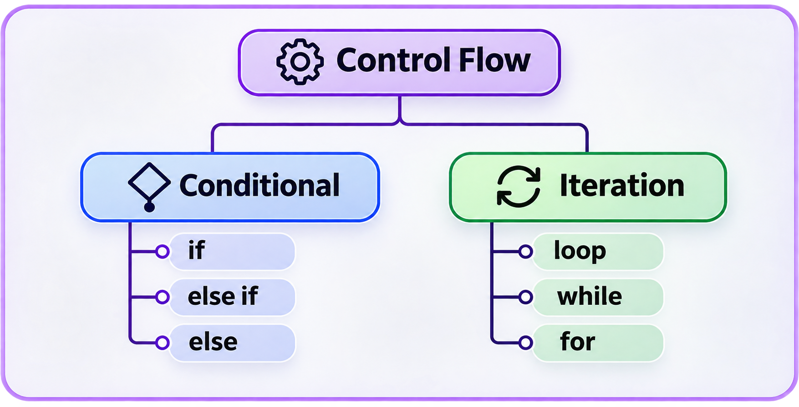
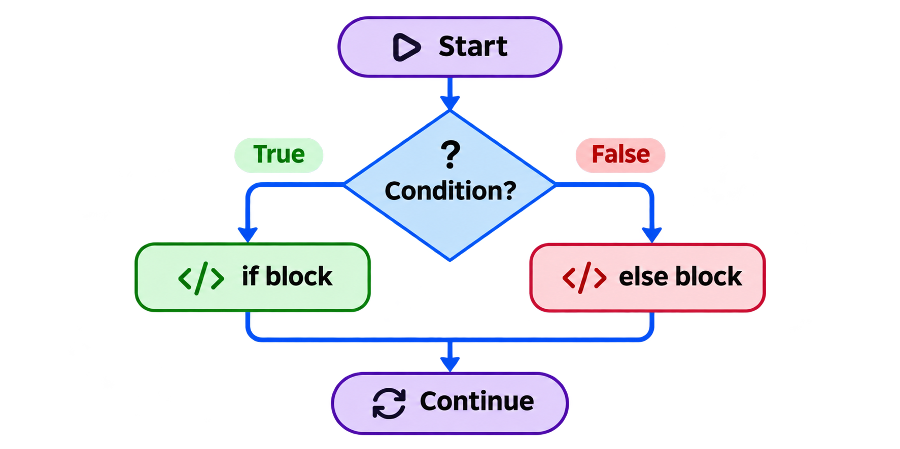
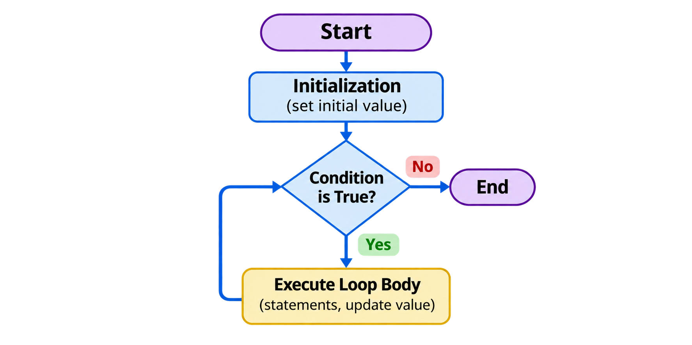
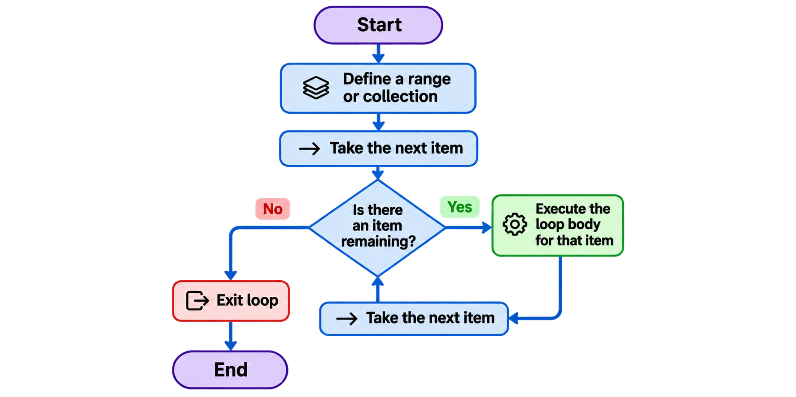
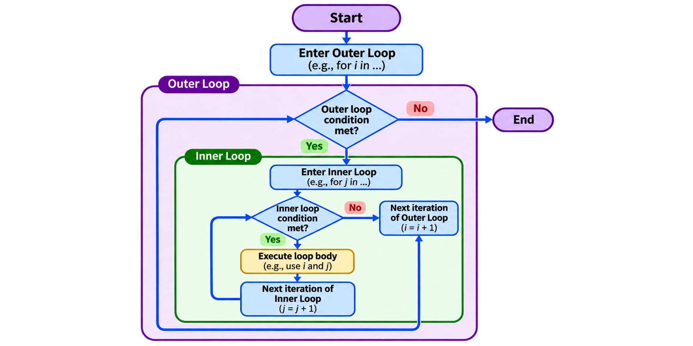
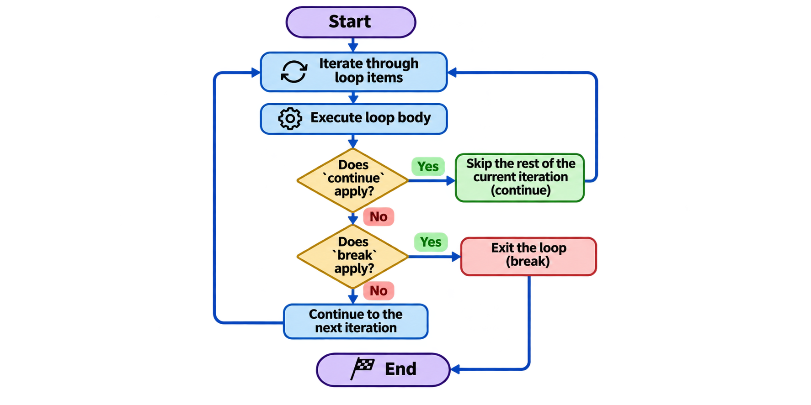

# Control Flow

Control flow determines which code runs and how often it runs. Rust provides conditional expressions, pattern matching, loops, and explicit loop-control statements.



## Contents

1. [if and else](#1-if-and-else)
2. [if as an expression](#2-if-as-an-expression)
3. [match](#3-match)
4. [loop](#4-loop)
5. [while](#5-while)
6. [for](#6-for)
7. [break and continue](#7-break-and-continue)
8. [Loop labels](#8-loop-labels)
9. [let ... else](#9-let--else)

## 1. `if` and `else`

An `if` expression runs a block when its condition is `true`. The condition must be a `bool`; Rust does not treat numbers as truth values:



```rust
let score = 82;

if score >= 50 {
    println!("Passed");
} else {
    println!("Try again");
}
```

Use `else if` for multiple mutually exclusive conditions:

```rust
if score >= 90 {
    println!("A");
} else if score >= 75 {
    println!("B");
} else {
    println!("C or below");
}
```

## 2. `if` as an expression

Because `if` produces a value, both branches must return compatible types:

```rust
let status = if score >= 50 { "pass" } else { "fail" };
```

Use a semicolon after the complete `if` expression when it is used as a statement.

## 3. `match`

`match` compares a value against patterns. Its arms are checked for exhaustiveness, so every possible case must be handled:

```rust
let code = 200;

let message = match code {
    200 => "Success",
    404 => "Not found",
    500..=599 => "Server error",
    _ => "Other response",
};
```

Use `_` as a catch-all pattern when the remaining values do not need separate handling. Each arm may contain a block and return a value.

## 4. `loop`

`loop` repeats its body indefinitely until it reaches `break`:

```rust
let mut attempts = 0;

let result = loop {
    attempts += 1;
    if attempts == 3 {
        break attempts * 10;
    }
};
```

Unlike `while` and `for`, a `loop` is useful when termination depends on logic inside the body. It can return a value with `break value`.

## 5. `while`

`while` repeats while its boolean condition remains true:



```rust
let mut count = 3;

while count > 0 {
    println!("{count}");
    count -= 1;
}
```

Make sure the loop body can eventually make the condition false.

## 6. `for`

`for` iterates over a collection or range:



```rust
for number in 1..=3 {
    println!("{number}");
}

let names = ["Ana", "Ben"];
for name in names {
    println!("{name}");
}
```

### Nested `for` loops

A nested loop runs the inner loop completely for each iteration of the outer loop:



```rust
for row in 1..=2 {
    for column in 1..=3 {
        println!("row {row}, column {column}");
    }
}
```

By default, `break` and `continue` affect the nearest loop. Use a loop label when control must target an outer loop.

Use `.iter()` to borrow collection elements, `.iter_mut()` to modify them, or `.into_iter()` when consuming the collection is intended.

## 7. `break` and `continue`

- `break` exits the nearest loop.
- `continue` skips the rest of the current iteration and starts the next one.



```rust
for number in 1..=10 {
    if number % 2 == 0 {
        continue;
    }
    if number > 7 {
        break;
    }
    println!("{number}");
}
```

## 8. Loop labels

Labels let `break` or `continue` target an outer loop. A label begins with a single quote:

```rust
'outer: for row in 0..3 {
    for column in 0..3 {
        if row == 1 && column == 1 {
            break 'outer;
        }
    }
}
```

Use labels sparingly; extracting a function can make complex nested control flow clearer.

## 9. `let ... else`

`let ... else` destructures a value when a pattern must match. The `else` block must diverge by returning, breaking, or otherwise never continuing normally:

```rust
fn first_name(input: Option<&str>) -> &str {
    let Some(name) = input else {
        return "unknown";
    };

    name
}
```

This is useful when the successful path should remain at the current scope instead of becoming deeply nested.

[Pattern Matching](<../../07 - Pattern Matching/README.md>) takes these examples further with destructuring, guards, and exhaustiveness.

## Practice

1. Write an `if` expression that classifies a score.
2. Use `match` to convert a number into a status message.
3. Build a `loop` that returns a value with `break`.
4. Count down with `while`.
5. Iterate over an array with `for`.
6. Skip even values with `continue` and stop at a limit with `break`.
7. Use a loop label to exit nested loops.
8. Use `let ... else` to handle a missing value.

## Source reference

This lesson consolidates Rust control-flow fundamentals and links naturally to the detailed [Rust Book Control Flow chapter](https://doc.rust-lang.org/book/ch03-05-control-flow.html).

---

[← Previous: Comments](<../11 - Comments/README.md>) | [Back to Programming Fundamentals](../README.md) | [Next: Memory Management Fundamentals →](<../../03 - Memory Management Fundamentals/README.md>)
