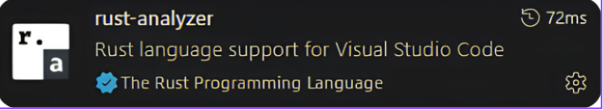

# Environment Setup

## Step 1 — Install Microsoft C++ Build Tools

### Why is this required?

On Windows, Rust's recommended MSVC toolchain needs Microsoft's linker to build executable programs.

### Installation steps

1. Open the [Microsoft C++ Build Tools download page](https://visualstudio.microsoft.com/downloads/).
2. Download and run the installer.
3. Select **Desktop development with C++**.
4. Ensure the **MSVC C++ build tools** and **Windows SDK** components are selected.
5. Click **Install**.

> [!NOTE]
> You do not need the full Visual Studio IDE. The standalone build tools are sufficient. Rustup can also help install these prerequisites when they are missing.

### Visual Studio Installer selection

The installer should have the **Desktop development with C++** workload selected, including the MSVC build tools and a Windows SDK.


---

## Step 2 — Install Rust using Rustup

### Why Rustup?

Rustup installs and manages the Rust compiler, Cargo, and Rust toolchain updates.

### Installation steps

1. Visit the [official Rustup installer](https://rustup.rs/).
2. Download `rustup-init.exe` for Windows, usually the 64-bit version.
3. Run the installer.
4. Choose the default installation option.

### Tools installed by Rustup

| Tool | Purpose |
| --- | --- |
| `rustup` | Manages Rust versions and toolchains |
| `rustc` | Compiles Rust code |
| `cargo` | Builds projects and manages packages |
| `rustfmt` | Formats Rust code |
| `clippy` | Detects common code issues |

For standard Windows development, use the stable MSVC toolchain.

### Select the default installation

When the installer displays the available options, press **Enter** to choose option `1` and continue with the standard installation.

> [!TIP]
> 🟢 Select **Option 1 — Proceed with standard installation**, then press **Enter**.

```text
The Cargo home directory is located at:

  C:\Users\<username>\.cargo

This can be modified with the CARGO_HOME environment variable.

The cargo, rustc, rustup and other commands will be added to
Cargo's bin directory, located at:

  C:\Users\<username>\.cargo\bin

This path will then be added to your PATH environment variable by
modifying the PATH registry key at HKEY_CURRENT_USER\Environment.

You can uninstall at any time with rustup self uninstall and
these changes will be reverted.

Current installation options:

   default host triple: x86_64-pc-windows-msvc
     default toolchain: stable (default)
               profile: default
  modify PATH variable: yes

1) Proceed with standard installation (default - just press enter)
2) Customize installation
3) Cancel installation
> 1
```

---

## Step 3 — Verify the installation

After installation, close and reopen PowerShell or your terminal so the updated `PATH` is loaded.

Run each command separately:

```powershell
rustc --version
```

```powershell
cargo --version
```

```powershell
rustup --version
```

### Example terminal output

```text
Windows PowerShell 5.1
Copyright (C) Microsoft Corporation. All rights reserved.

PS C:\WINDOWS\System32> rustc --version
rustc 1.100.0 (0ef1bc386 2026-11-09)

PS C:\WINDOWS\System32> cargo --version
cargo 1.100.0 (3acc79c0c 2026-11-05)

PS C:\WINDOWS\System32> rustup --version
rustup 1.29.3 (edbc831ce 2026-11-02)
info: This is the version for the rustup toolchain manager, not the rustc compiler.
info: The currently active `rustc` version is `rustc 1.100.0 (0ef1bc386 2026-11-09)`
```

> [!NOTE]
> Version numbers and release dates may differ depending on when Rust was installed or last updated.

Each command should display its installed version number.

Check the active Rust toolchain:

```powershell
rustup show
```

The output should show an active stable toolchain. On a standard 64-bit Intel or AMD Windows PC, the toolchain usually ends with `x86_64-pc-windows-msvc`.

---

## Step 4 — Configure VS Code

### Install rust-analyzer

1. Open Visual Studio Code.
2. Open **Extensions** by pressing `Ctrl + Shift + X`.
3. Search for `rust-analyzer`.
4. Select the official [rust-analyzer extension](https://marketplace.visualstudio.com/items?itemName=rust-lang.rust-analyzer) published by **The Rust Programming Language**.
5. Click **Install**.



### What rust-analyzer provides

The extension adds essential Rust development features to VS Code, including:

- Code completion and automatic import suggestions
- Error detection and suggested fixes
- Type information and documentation on hover
- Go to definition, implementation, and type definition
- Reference search, symbol renaming, and navigation
- Inlay hints and semantic syntax highlighting

> [!NOTE]
> No additional Rust extensions are required at this stage. The official `rust-analyzer` extension provides the core language support needed for learning and developing Rust in VS Code.
