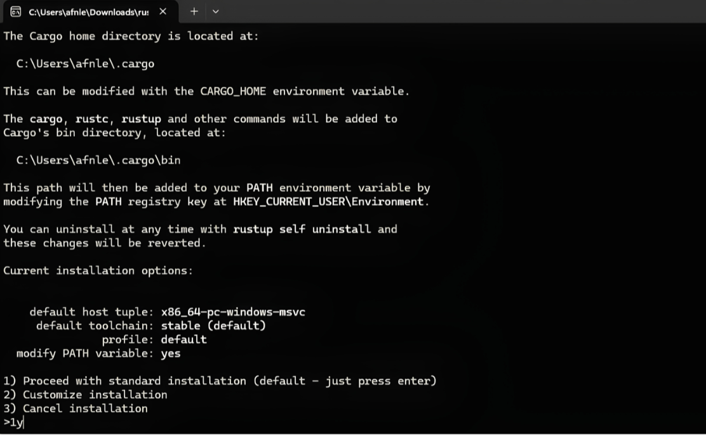

# Environment Setup

## Step 1 — Install Microsoft C++ Build Tools

### Why is this required?

On Windows, Rust's recommended MSVC toolchain needs Microsoft's linker to build executable programs.

### Installation steps

1. Open the [Microsoft C++ Build Tools download page](https://visualstudio.microsoft.com/downloads/).
2. Download and run the installer.
3. Select **Desktop development with C++**.
4. Ensure the **MSVC C++ build tools** and **Windows SDK** components are selected.
5. Click **Install**.

> [!NOTE]
> You do not need the full Visual Studio IDE. The standalone build tools are sufficient. Rustup can also help install these prerequisites when they are missing.

### Visual Studio Installer selection

The installer should have the **Desktop development with C++** workload selected, including the MSVC build tools and a Windows SDK.

---

## Step 2 — Install Rust using Rustup

### Why Rustup?

Rustup installs and manages the Rust compiler, Cargo, and Rust toolchain updates.

### Installation steps

1. Visit the [official Rustup installer](https://rustup.rs/).
2. Download `rustup-init.exe` for Windows, usually the 64-bit version.
3. Run the installer.
4. Choose the default installation option.

### Tools installed by Rustup

| Tool | Purpose |
| --- | --- |
| `rustup` | Manages Rust versions and toolchains |
| `rustc` | Compiles Rust code |
| `cargo` | Builds projects and manages packages |
| `rustfmt` | Formats Rust code |
| `clippy` | Detects common code issues |

For standard Windows development, use the stable MSVC toolchain.

### Select the default installation

When the installer displays the available options, press **Enter** to choose option `1` and continue with the standard installation.

