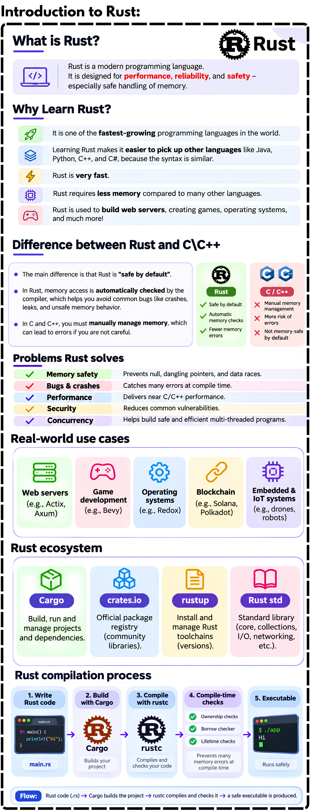
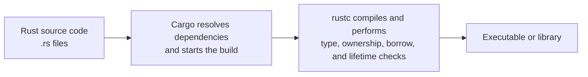

# Introduction to Rust

Rust is a compiled, statically typed programming language designed for performance, reliability, and memory safety. It gives developers low-level control while preventing many common memory and concurrency errors during compilation.



## Contents

1. [What is Rust?](#what-is-rust)
2. [Why learn Rust?](#why-learn-rust)
3. [Rust and C/C++](#rust-and-cc)
4. [Problems Rust solves](#problems-rust-solves)
5. [Real-world use cases](#real-world-use-cases)
6. [The Rust ecosystem](#the-rust-ecosystem)
7. [The Rust compilation process](#the-rust-compilation-process)

## What is Rust?

Rust is a systems programming language that combines predictable performance with strong compile-time checks. Its ownership and borrowing model manages memory without requiring a garbage collector.

Rust provides:

- Native-code performance
- Static typing and type inference
- Memory safety in safe Rust
- Concurrency checks at compile time
- Modern tooling through Cargo and Rustup
- Cross-platform support

> [!NOTE]
> Rust also supports `unsafe` code for low-level operations. Inside an `unsafe` block, the programmer is responsible for maintaining Rust's safety requirements.

## Why learn Rust?

Rust is useful when software needs speed, predictable resource usage, and strong correctness guarantees.

- **Performance:** Rust compiles to native machine code and supports zero-cost abstractions.
- **Memory efficiency:** Ownership manages resources without garbage-collection pauses.
- **Reliability:** The compiler catches many type, lifetime, ownership, and borrowing mistakes before execution.
- **Safer concurrency:** Rust prevents many data races through its type and ownership systems.
- **Transferable concepts:** Learning ownership, lifetimes, and explicit error handling strengthens systems-programming skills.
- **Integrated tooling:** Cargo provides a consistent workflow for creating, building, testing, documenting, and publishing projects.

## Rust and C/C++

Rust and C/C++ can all produce high-performance native software. Their main difference is how they enforce memory and concurrency safety.

| Area | Rust | C/C++ |
| --- | --- | --- |
| Memory safety | Checked by the compiler in safe Rust | Relies on programmer discipline, language rules, and supporting tools |
| Memory management | Ownership, borrowing, and RAII | Manual techniques, RAII, and smart pointers |
| Null handling | Uses types such as `Option<T>` | Null pointers are available |
| Concurrency | Prevents many data races at compile time | Synchronization correctness is primarily the programmer's responsibility |
| Abstraction | Zero-cost abstractions | Zero-cost abstractions, especially in C++ |
| Interoperability | Can call C-compatible interfaces through FFI | C is a common interoperability boundary |

Rust moves many safety checks into the compiler while preserving the control expected from a systems language.

## Problems Rust solves

In safe Rust, the compiler helps prevent several common sources of defects:

- Use-after-free and dangling-reference errors
- Invalid shared mutation
- Many data races in concurrent programs
- Accidental null access through ordinary references
- Missed cleanup on ordinary scope exits through automatic RAII-based cleanup
- Hidden failure paths by representing recoverable errors with `Result` and optional values with `Option`

Rust does not eliminate every software bug, but it removes many unsafe program states before the code can run.

## Real-world use cases

Rust is used across several software domains:

| Domain | Typical work | Example technologies |
| --- | --- | --- |
| Web services | Fast APIs, networking, and backend services | Axum, Actix Web |
| Command-line tools | Portable developer and automation tools | Cargo-based CLI applications |
| Operating systems | Kernels, drivers, and low-level components | Redox OS |
| Game development | Game engines, tools, and simulations | Bevy |
| Embedded systems | Firmware, robotics, and IoT devices | Embedded Rust ecosystem |
| Blockchain | Runtimes, nodes, and smart-contract tooling | Solana, Polkadot |

## The Rust ecosystem

| Component | Purpose |
| --- | --- |
| `rustup` | Installs Rust and manages toolchains, versions, and compilation targets |
| `rustc` | Compiles Rust source code |
| Cargo | Creates, builds, runs, tests, and documents Rust projects |
| crates.io | Hosts community packages called crates |
| Rust standard library | Provides core types, collections, input/output, networking, threading, and more |
| `rustfmt` | Formats Rust source code consistently |
| Clippy | Provides additional lint checks and code-improvement suggestions |
| rust-analyzer | Adds Rust language support to editors such as VS Code |

## The Rust compilation process



Common Cargo commands:

```powershell
cargo check
cargo build
cargo run
cargo build --release
```

- `cargo check` validates the project without producing the final executable.
- `cargo build` creates a debug build.
- `cargo run` builds and runs the project.
- `cargo build --release` creates an optimized release build.

## Next step

Continue with the [Windows environment setup guide](<../Environment Setup/README.md>) to install the required build tools, Rustup, and VS Code support.
